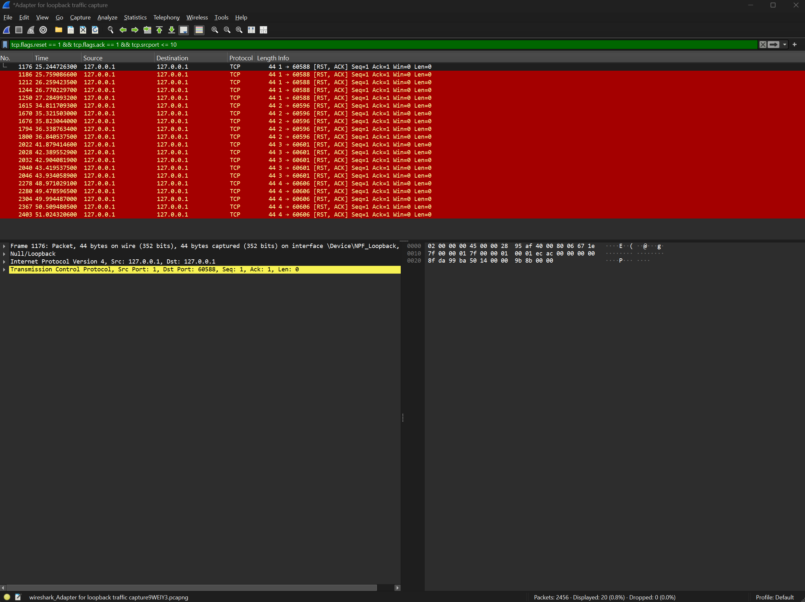
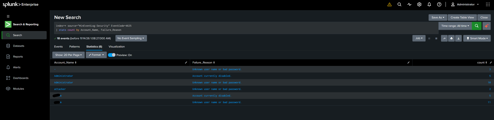
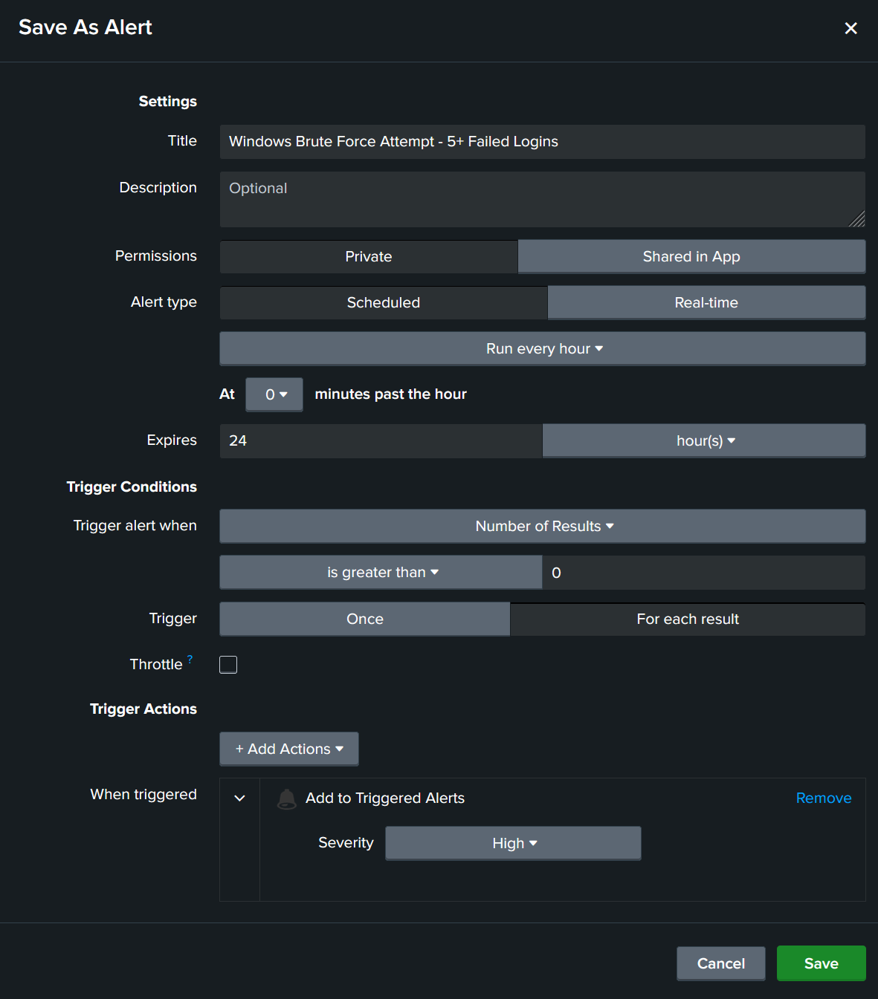
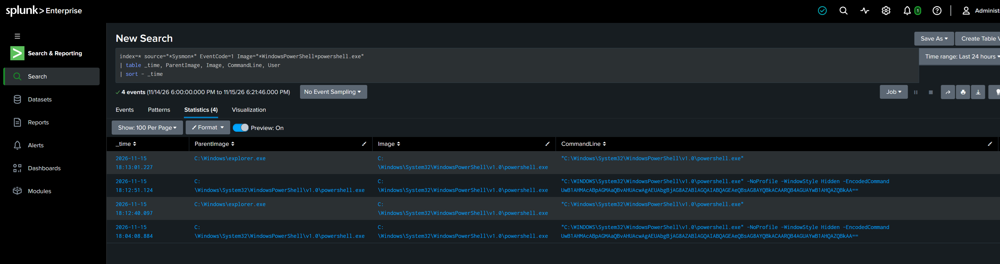
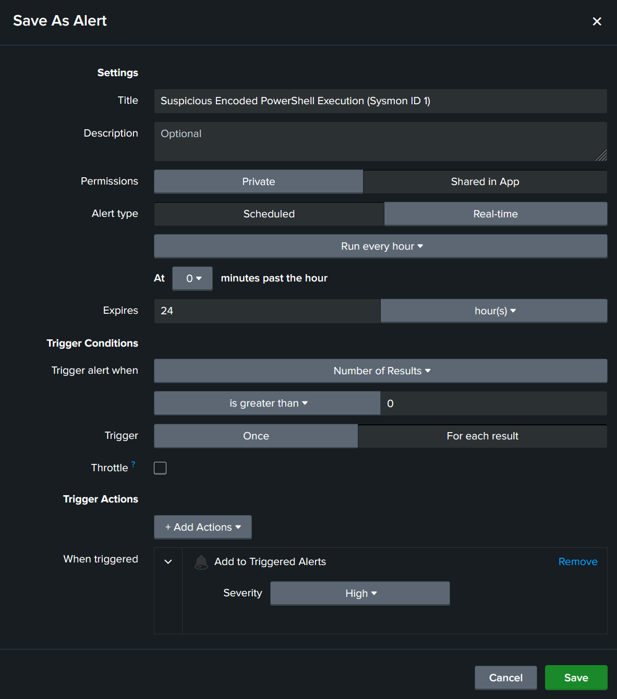

# Windows Endpoint & Network Threat Detection Lab

## Project Overview
This home lab demonstrates end-to-end threat detection by simulating network enumeration and brute-force authentication attempts on a Windows 11 host, analyzing packet captures in **Wireshark**, and building automated detection alerts in **Splunk Enterprise**.

## Lab Architecture & Tools
* **Host OS:** Windows 11
* **SIEM:** Splunk Enterprise (Ingesting local `WinEventLog:Security` and `WinEventLog:System`)
* **Network Analyzer:** Wireshark (Loopback traffic capture)

## Attack Simulation & Investigation

### 1. Network Port Enumeration
* **Simulation:** Executed a PowerShell loop testing TCP connections across ports 1–10 on localhost (`127.0.0.1`).
* **Wireshark Analysis:** Applied the display filter `tcp.flags.reset == 1 && tcp.flags.ack == 1 && tcp.srcport <= 10` to isolate rejected connection attempts, confirming sequential port probing while filtering out background traffic.
* 

### 2. Brute-Force Authentication Simulation
* **Simulation:** Generated consecutive failed authentication attempts against the local `Administrator` account via `runas` to trigger Windows Security **Event ID 4625**.
* **Splunk Investigation:** Queried the Security event log to isolate the targeted account and failure reasons (`Unknown user name or bad password.` and `Account currently disabled.`):
  ```spl
  index=* source="WinEventLog:Security" EventCode=4625
  | stats count by Account_Name, Failure_Reason
  ```
* 

### 3. Automated Alert Engineering
Created a shared, scheduled Splunk alert (`Windows Brute Force Attempt - 5+ Failed Logins`) to trigger a **High** severity alert whenever an account experiences 5 or more failed logins (`EventCode=4625`):
```spl
index=* source="WinEventLog:Security" EventCode=4625
| stats count by Account_Name
| where count >= 5
```
* 

---

## Lab 2: Sysmon Process Creation & Encoded PowerShell Detection

### Overview & MITRE ATT&CK Mapping
Standard Windows Security logs lack visibility into full command-line arguments. Installed **Sysmon** and forwarded `Microsoft-Windows-Sysmon/Operational` logs to Splunk to detect obfuscated command execution (**MITRE ATT&CK T1059.001 — PowerShell**).

### 1. Attack Simulation & Process Tree Investigation
* **Simulation:** Executed a Base64-encoded PowerShell payload (`-EncodedCommand`) from `cmd.exe` to mimic obfuscated attacker execution.
* **Splunk Investigation:** Queried **Sysmon Event ID 1 (Process Creation)** to inspect parent-child process relationships (`ParentImage` -> `Image`) and full `CommandLine` arguments:
  ```spl
  index=* source="*Sysmon*" EventCode=1 Image="*WindowsPowerShell*powershell.exe"
  | table _time, ParentImage, Image, CommandLine, User
  | sort - _time
  ```
* 

### 2. Encoded PowerShell Alert Engineering
Created a shared, **High** severity scheduled alert (`Suspicious Encoded PowerShell Execution (Sysmon ID 1)`) to detect obfuscated PowerShell flags (`-enc` / `-EncodedCommand`):
```spl
index=* source="*Sysmon*" EventCode=1 Image="*powershell.exe" (CommandLine="*-enc*" OR CommandLine="*-EncodedCommand*")
| stats count by _time, User, ParentImage, CommandLine
```
* 

## Key Takeaways & Next Steps
* Correlating host-level logs (Event ID 4625) with network telemetry (TCP RST packets) reduces false positives during SOC triage.
* **Future Improvement:** Install **Sysmon** on the Windows host to gain deeper visibility into process creation (`Event ID 1`) and network connections (`Event ID 3`) inside Splunk.
